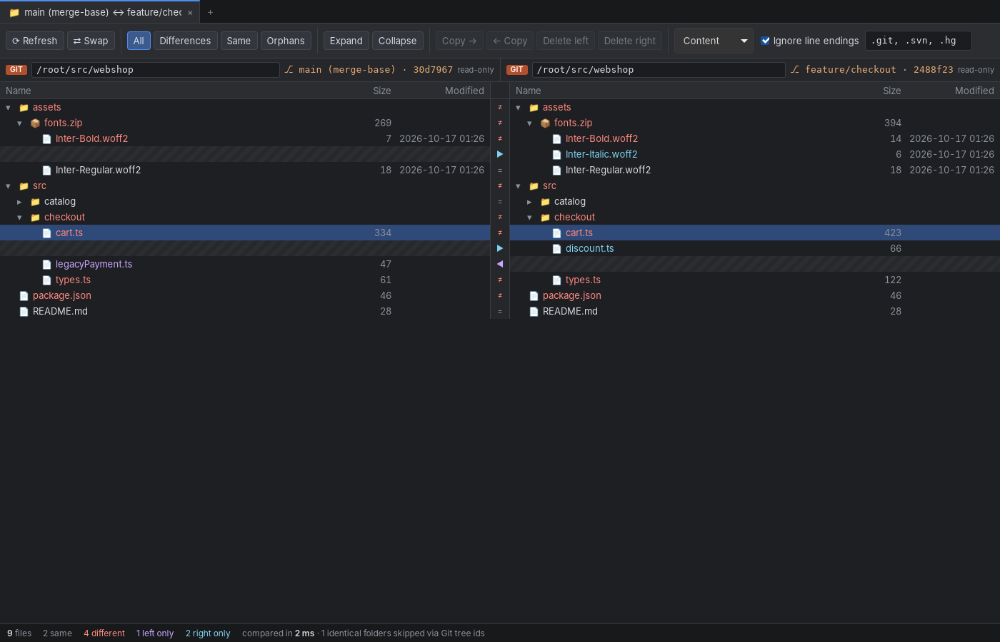
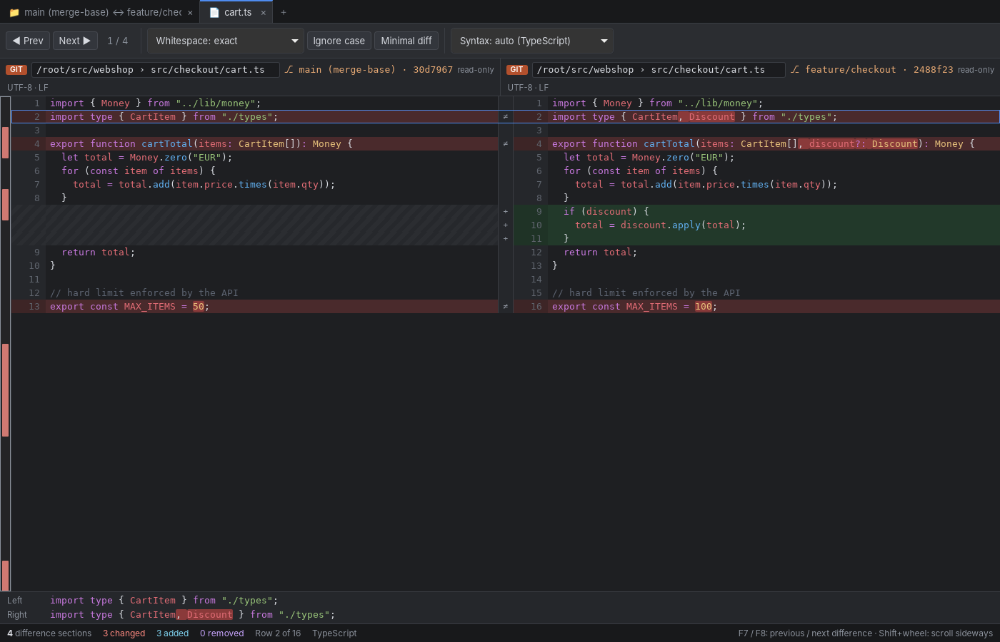
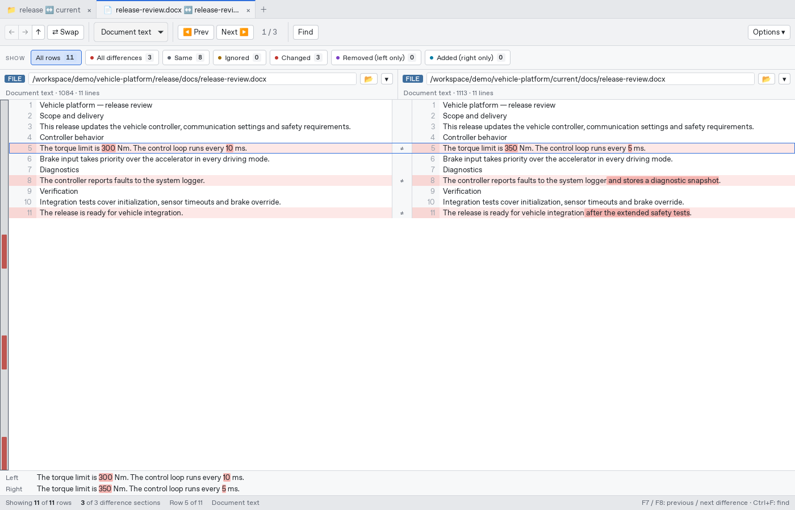
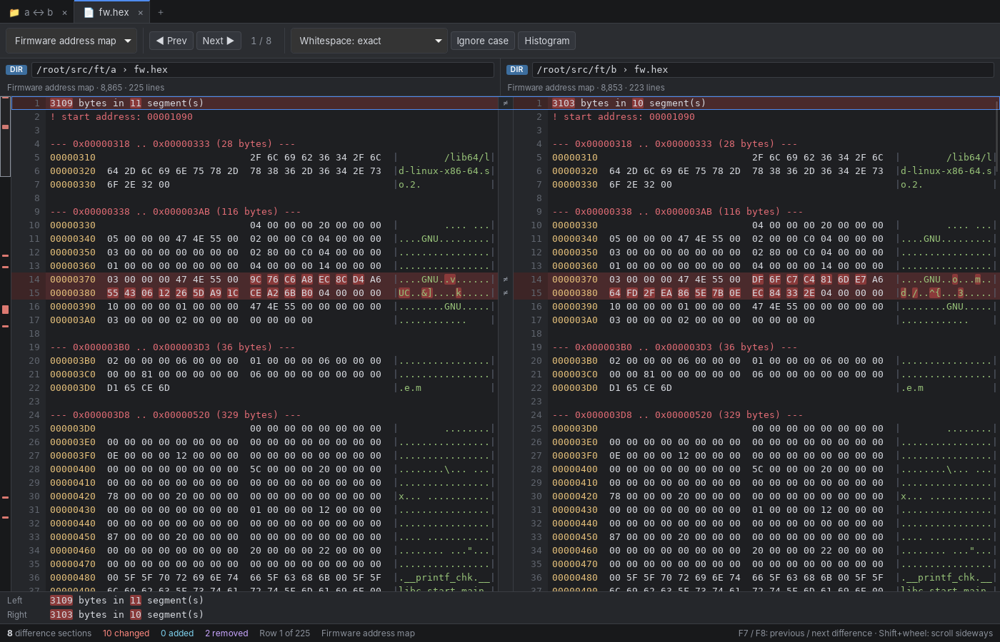
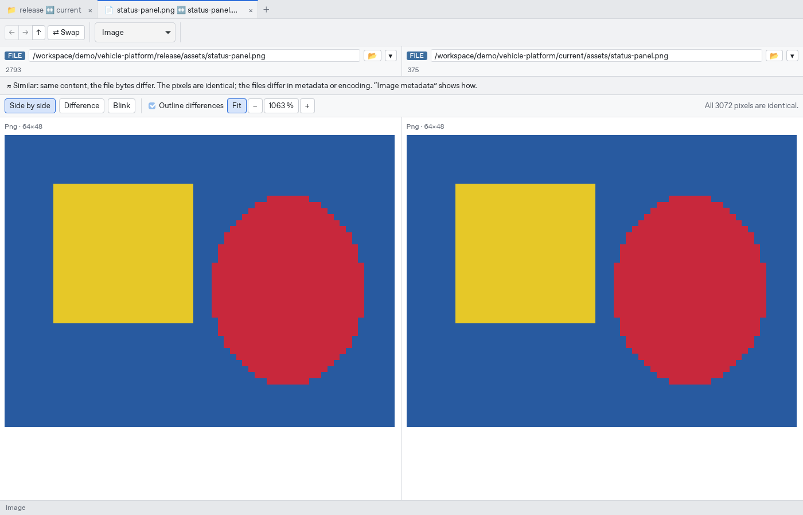

# ParallaxCompare

A fast side-by-side folder and file compare tool for Windows and Linux, in the spirit of Beyond Compare. Folders, archives and Git revisions are all *sources*, and any source can be compared with any other:

- a folder against a folder
- a `.zip` / `.7z` / `.tar.gz` against a folder, or against another archive
- branch `main` against branch `feature/x`, read straight from the repository with no checkout
- a Git revision against the working tree
- archives nested inside folders, inside other archives, or stored in a Git commit, which expand like folders





The design rationale, the GUI mockups and a comparison with existing tools are in [docs/concept.html](docs/concept.html).

## Features

| | |
|---|---|
| **Sources** | Local folders and files · zip and zip-based formats (jar, war, nupkg, vsix, whl, apk …) · 7z · tar, tar.gz, tar.xz, tar.zst, tar.bz2 · Git branches, tags, commits and `HEAD~n` · Git working tree (honours `.gitignore`) |
| **Folder compare** | Aligned two-pane tree with missing-side placeholders · filters: all, differences, same, orphans · compare by content (default) or by size and date · **≈ similar** status for files whose bytes differ but whose content is equal (CRLF vs LF, re-saved documents with the same text, re-encoded images with the same pixels, Java classes recompiled with only debug info changed) · exclude globs · select several rows (Ctrl/Shift+click) to copy left↔right or delete at once, with progress and Cancel · copying asks first when it replaces files, and names those newer than the copy · deleting moves files to the Recycle Bin / Trash (inside archives it is for good, and the dialog says so) · rows update by themselves when files change on disk |
| **Git** | Compare any two revisions without a checkout · *merge-base* mode shows only what a branch changed since it branched off · identical folders are recognised by their tree id and skipped without being walked |
| **Content views** | Each file type is shown in the form that makes its changes readable, with raw text or a hex dump always one click away. See the table below. |
| **Text compare** | Line diff (Myers, or histogram as an option) with aligned rows and placeholders · changed words marked within each line · whitespace and case rules · overview strip · previous/next difference (F7/F8) · line-detail pane · encoding (UTF-8/16, legacy code pages) and line-ending detection · binary detection |
| **Editing** | Copy a difference to the other side with the arrows next to it or Alt+←/→ · double-click a line to edit it (Enter splits, Backspace/Delete join, multi-line paste) · undo/redo (Ctrl+Z/Ctrl+Y) · save with Ctrl+S, also into archives · the file's encoding, BOM and line endings are kept; files that would not save back byte for byte are not editable · unsaved changes are kept through whitespace and syntax changes, and closing asks first |
| **Syntax highlighting** | ~190 languages via the syntect grammars bundled with `bat`, plus A2L, DBC, Intel HEX and S-record; ARXML, ODX, CDD and other XML dialects are recognised as XML. Detected by file name, extension or shebang line, with a manual override |
| **CLI** | `parallax` for scripts and CI: tree or unified-diff output, JSON, `diff`-style exit codes |

### Content views

| Files | Default view | What it shows |
|---|---|---|
| `.docx` `.xlsx` `.pptx`, `.odt` `.ods` `.odp`, `.pdf` | Document text | Paragraphs (with headers, footers, footnotes, comments); one line per spreadsheet row, cells tab-separated, formulas as `{=…}`; slide text and notes; PDF text per page |
| `.doc` `.xls` `.ppt` | Document text | Converted with LibreOffice when it is installed (about 1 s per file) |
| Java `.class` files (also inside `.jar`, `.war`, `.ear`) | Class outline | Read directly, no JDK needed; about 0.4 ms per class. **Class outline**: version (with the Java release), declaration with generics, annotations, sealed/record/enum, nested classes, fields with constant values, methods with parameter names and `throws`, each with a checksum and count of its instructions, so a changed method body shows in the outline · **Bytecode**: every method's instructions with references resolved (`invokevirtual java.util.List.size(): int` instead of `#23`), jump targets as labels (`L1`) instead of byte offsets, locals by name, lambdas and string concatenation in short form · **Bytecode with line numbers**. Members are sorted, javac's class-wide lambda numbers are renumbered per method, and line numbers are left out of the plain bytecode view, so recompiling or editing one method does not change the lines of others. Classes whose code is equal apart from debug info (line numbers, local names, source file) are ≈ similar in folder compares |
| WebAssembly `.wasm` modules | Module outline | Read directly with `wasmparser`. **Module outline**: imports, exports, memories, tables, globals, data and element segments, custom sections with sizes, producers, and every function's signature with a checksum and count of its instructions · **WebAssembly text**: every function's instructions with functions, globals and locals by name (name section, else export and import names; Rust names demangled), blocks indented. Functions are sorted by name and checksums hash names instead of indexes, so adding a function does not change other lines. Modules whose sections are equal apart from custom sections (names, producers, DWARF) are ≈ similar |
| .NET assemblies (`.dll`, `.exe` with a CLI header) | Assembly outline | ECMA-335 metadata read directly, no .NET needed. **Assembly outline**: name, version, culture, public key token, references, assembly attributes, every type (C# style declaration with generics, constraints, base and interfaces) with fields, constants, properties, events and methods, each method with a checksum and count of its IL instructions, and the build identity (MVID, PDB path) · **IL**: every method's IL with tokens resolved to names, branch targets as labels, short and long forms folded · **Executable summary** as for native files. Rebuilds that differ only in MVID, timestamp, PDB path or layout are ≈ similar |
| Android binary XML (`AndroidManifest.xml`, `res/**/*.xml` inside `.apk`) | Android XML | Decoded to XML text, one attribute per line, typed values as aapt writes them (`16.0dp`, `#ff0080ff`, `true`), resource references as `@0x7f…` |
| ELF, PE, Mach-O | Executable summary | Header, build id, sections with address, size and CRC32, symbols sorted by name, imports |
| `.dbc` CAN databases | CAN database | Messages sorted by id (hex, standard/extended, DLC, sender, cycle time) with their signals sorted by multiplexer value and start bit (layout, byte order, sign, factor/offset, range, unit, receivers, value descriptions, comments, attributes with enum values resolved), nodes, value tables, attribute definitions, environment variables; unknown statements kept. Same database in another order or number format is ≈ similar |
| `.a2l` (ASAM MCD-2 MC) | A2L objects | Streaming parser, about 14 ms per MB. Every object as a block, sorted by kind and name: positional parameters labelled (address normalized to `0x0001A2B4`, so a rebuild shows as changed `Address:` lines), keywords, `AXIS_DESCR`, reference lists one per line, `IF_DATA` summarized; comments dropped. Same objects in another order or formatting are ≈ similar |
| `.map` linker maps (GNU ld, LLVM lld) | Memory map | Memory regions with use, output sections by address, size by object (total and per section), symbols sorted by name with address, size and object. Other linkers' maps and JSON source maps open as text |
| ELF with DWARF debug info | Debug symbols | After the executable summary: global and static variables with resolved types, size and address, and functions with address range; units read in parallel (112 MB of `.debug_info` in about 1 s) |
| `.mf4` `.mdf` measurements (MDF 4 and 3) | Measurement summary | Only the block tree is read, never the samples: header and metadata, file history, channel groups (cycles, record size, source) with channels (unit, data type, bit position, conversion with tables, source), attachments |
| `.cdfx` calibration data (ASAM CDF 2) | Calibration values | Every instance sorted by name: category, unit, values one per line (`[1][2] = 3.5`), axes, history; revision in the header. Same values in another order or formatting are ≈ similar |
| `.hex` `.s19` `.srec` `.mot` … | Firmware address map | Records decoded into a 16-byte aligned memory map, so different record lengths or order still line up; checksum errors are reported |
| `.png` `.jpg` `.gif` `.bmp` `.webp` `.tif` `.ico` | Image | Side by side, difference overlay or blink; count and bounding box of differing pixels |
| `.svg` | Text (XML) | Image view renders it |
| XML/JSON with very long lines | Pretty-printed | Minified files re-indented, one element per line |
| `.gguf` models (llama.cpp, Ollama, LM Studio) | Model summary | Read from the file header only, so a 70 GB model opens as fast as a small one. Views: **Model summary** (architecture, parameters, context length, heads and KV heads, RoPE, tokenizer, file type, bits per weight) · **Chat template** (Jinja source; templates stored as one line are broken at tags) · **Chat template, rendered** (the template applied to sample conversations, including a tool call, so the prompts the model sees are compared rather than the template text) · **Metadata** (every key, sorted) · **Tokenizer** (special tokens, then every token by id) · **Tensors and quantization** (recipe per type, a layer map of types per weight matrix, every tensor with shape, type and size) |
| SQLite databases (`.db` `.sqlite` `.sqlite3` `.db3`, or any name: detected by content) | Database schema | Read directly from the file format, no SQLite library; only the pages a view needs are touched. **Database schema**: header settings, then per table one line per column and table constraint, its indexes and triggers, then the views, sorted by name, SQL with whitespace and comments normalized · **Database rows**: per table the columns and row count, then the rows in rowid or primary-key order, one tuple per line (text over 200 characters and blobs over 32 bytes shortened with a SHA-256), up to 1 000 rows per table and 10 000 in all. Columns added with `ALTER TABLE` show their default in old rows, so an edit shows as the changed rows only. Databases with the same schema and rows are ≈ similar in folder compares (e.g. after `VACUUM`, or another page size or text encoding) |
| Parquet, Arrow IPC / Feather v2 (`.arrow` `.feather`) | Data file summary | Decoded from the footer only (Thrift resp. FlatBuffers, read by hand), so a gigabyte file opens in milliseconds. Parquet: schema with logical types and nesting, rows, key/value metadata, per column codec, sizes and null counts, per row group every column chunk with encodings and min/max statistics decoded by type (dates, timestamps, decimals, strings). Arrow: schema, dictionary encoding, metadata, null counts per field and the record batches. There is no rows view: decoding the compressed data pages would take most of a Parquet implementation |
| `.safetensors` models | Model summary | Read from the JSON header only. **Model summary** (parameters, tensors, layers, bits per weight, data types with their share, `__metadata__`) · **Tensors** (data types, a layer map of dtypes per weight matrix for `….layers.N.…` names, every tensor in natural order with shape, dtype, size and, for tensor data up to 256 MiB, a CRC32). Files with the same tensors and only other `__metadata__` are ≈ similar (checked up to 4 GiB of tensor data) |
| `.onnx` models | Model graph | Protobuf decoded by hand. IR version, producer, opsets, metadata props, inputs and outputs with element types and (symbolic) shapes, initializers sorted by name with dtype, shape, size and CRC32 (tiny ones with their values), every node in graph order as `Op(inputs) -> outputs {attributes}  // name`, with If/Loop bodies indented below their node, functions and value infos |
| Other binary files | Hex dump | Up to 16 MB |







## Writing to archives

Copy and delete work inside zip, 7z and tar archives, including archives nested in other archives; Git revisions are read-only. Each operation rewrites the archive once: the new archive is written to a temporary file next to the old one and then renamed over it, so a failed write leaves the old archive intact.

- **zip:** unchanged entries are copied as stored, without recompressing. A change to a 60 MB zip with 23 000 files takes 0.2–0.3 s.
- **7z:** unchanged blocks are copied as stored, so adding files is quick (about 1 s for a 27 MB archive). Replacing or deleting a file in a *solid* block means decompressing that block and compressing the rest of it again, as 7-Zip does: about 22 s on 4 cores for a block holding 247 MB.
- **tar, .tar.gz, .tar.xz, .tar.bz2, .tar.zst:** the whole archive is compressed again.

New entries are compressed with deflate (zip) or LZMA2 at 7-Zip's default level (7z, .tar.xz). File permissions are not carried over: new tar entries get mode 644 (folders 755).

## Watching for changes

Local folders, archives and files are watched while they are compared. A change outside the app updates only the rows it affects: a changed file is compared again on its own, a new file is inserted into its folder, and a burst of changes (a build, a checkout) is collected for a moment and merged into the few folders it touched, or one full compare when it reaches the top. A file open in a text tab is reloaded, or, with unsaved edits, a banner offers to reload it. Excluded folders and the app's own writes do not count.

On Linux, where each folder needs its own watch, only the folders the compare shows are watched: folders hidden by `.gitignore` (`target/`, `node_modules/` …) and excluded folders are left out, and new folders are added as they appear. Watching the 3 500 folders of the test tree takes about 0.15 s, in the background; 5 000 files written in 0.15 s arrive as one update 0.35 s later.

## Performance

All of the work happens in a multi-threaded Rust core; the UI only renders the rows that are visible.

- **Git vs. Git:** tree ids are compared before anything is read. An unchanged folder costs a single id comparison, however large it is. Changed files are decided by their blob ids, without inflating the objects.
- **Archives:** zip and 7z entries are compared with the CRC32 stored in the archive headers, so nothing is decompressed for listing.
- **Git vs. local file:** the local file's Git blob id is computed and compared, instead of reading the Git object.
- **Local files:** parallel walking (rayon), files are memory-mapped, and size mismatches short-circuit.
- **Text views:** rows, intra-line marks and syntax colours are produced only for the visible window. Highlighter state is checkpointed every 128 lines, so jumping to line 900 000 does not re-parse the file from the top.

Measured with the CLI on two Linux kernel releases (v6.11 and v6.12, ~87 000 files, 1.6 GB per tree). The machine is a 4-core cloud VM, the OS file cache was warm, and each time is the full wall-clock run including output:

| Comparison | 1 thread | 4 threads |
|---|---|---|
| Git tag vs. Git tag (read from the object database) | 1.9 s | 0.51 s |
| Folder vs. folder, by content | 2.0 s | 0.59 s |
| Folder vs. folder, nearly identical (all 1.6 GB read) | 1.8 s | 0.58 s |
| Folder vs. folder, quick (size and date) | 0.62 s | 0.23 s |
| Worktree vs. `HEAD` (one file edited) | 2.2 s | 0.69 s |
| Text diff, 1 million lines (55 MB), 2 500 changed lines | 0.41 s | — |

Opening files with the content views (same machine): a 12 MB ARXML (242 000 lines) diffs in about 35 ms, and highlighting anywhere in it takes under 10 ms. A 5 MB Latin-1 A2L with 10 000 changed lines diffs in 0.1 s; with histogram instead of Myers it takes 0.9 s, which is why Myers is the default. A 300-page PDF extracts in 0.18 s, and a 100 000-row XLSX in 0.2 s.

Folder compares use every core: with 4 threads they run 3.5–3.8× faster, at about 370 % CPU. A text diff of a single file runs on one core; the desktop app only renders and highlights the visible rows.

## Usage

### Desktop app

Start `parallax-compare` and pick the two sides in the *New comparison* dialog. You can also pass both sides on the command line:

```sh
parallax-compare ~/src/shop@main ~/src/shop@feature/checkout --merge-base
parallax-compare dist/ release-1.4.7z
parallax-compare old.txt new.txt
```

As a Git difftool:

```sh
git config --global difftool.parallax.cmd 'parallax-compare "$LOCAL" "$REMOTE"'
git config --global diff.tool parallax
git difftool --dir-diff main feature/x     # or simply: parallax-compare .@main .@feature/x
```

Keyboard: arrow keys, Enter (open or expand), ←/→ (collapse/expand), F5 (refresh), F7/F8 (previous/next difference), Ctrl+T (new tab), Ctrl+W (close tab).

### Source syntax (CLI and path fields)

| Text | Meaning |
|---|---|
| `path/to/folder`, `file.txt` | a local folder or file |
| `release.7z` | an archive, compared as a folder |
| `release.7z!/bin` | a folder inside an archive |
| `repo@main`, `repo@v1.4.0`, `repo@HEAD~3` | a Git revision of the repository at `repo` |
| `repo@main:src/lib` | a folder (or file) inside a Git revision |

A text that names an existing path is always read as a path, so folders with `@` in their name keep working.

### CLI

```console
$ parallax ~/src/shop@main ~/src/shop@feature/checkout
  ≠ assets/
  ≠ assets/fonts.zip/
  ≠ assets/fonts.zip/Inter-Bold.woff2
  → assets/fonts.zip/Inter-Italic.woff2
  ≠ src/
  ≠ src/checkout/
  ≠ src/checkout/cart.ts
  → src/checkout/discount.ts
  ← src/checkout/legacyPayment.ts
  ≠ src/checkout/types.ts
  ≠ package.json

9 files compared: 2 same, 4 different, 1 left only, 2 right only  (1 ms, 1 identical folders skipped via Git tree ids)
```

Files are compared through their content view, so `parallax old.docx new.docx` prints a diff of the document text, and two images report their differing pixels. `--raw` compares the plain bytes as text instead, and `--bytes` turns off the ≈ similar status in folder compares.

`parallax --help` lists all options (`--merge-base`, `--quick`, `--strict-eol`, `-x/--exclude`, `--json`, `--whitespace`, `--histogram`, `-U` …). Exit status: 0 identical or only similar, 1 different, 2 error.

## Building

Requirements: Rust 1.88+ and Node.js 20+. On Linux you also need the WebKitGTK development packages:

```sh
sudo apt install libwebkit2gtk-4.1-dev libgtk-3-dev libayatana-appindicator3-dev librsvg2-dev libxdo-dev
```

```sh
cargo test                       # core and CLI tests
cargo build --release -p parallax-cli

cd app
npm ci
npm run tauri dev                # desktop app with hot reload
npm run tauri build              # installers: MSI/NSIS on Windows, deb/rpm/AppImage on Linux
```

CI runs formatting, clippy, the Svelte type check and all tests on Ubuntu and Windows. Pushing a `v*` tag builds installers and the CLI as a draft GitHub release.

## Architecture

```
app/                      Tauri 2 desktop app
  src/                    Svelte 5 UI: tabs, new-comparison dialog, folder view, text view
  src-tauri/              commands: sessions, compare, expand, copy/delete, file diff rows
crates/parallax-core/     UI-agnostic engine (also used by the CLI)
  vfs/                    every source as a tree: local, archive, git, archive mount layer
  compare.rs              parallel folder compare with tree-id / CRC / blob-id shortcuts
  textdiff.rs             imara-diff line diff → aligned rows, intra-line ranges
  convert/                content views: office/PDF text, executables, firmware, pretty XML/JSON, hex, images
  syntaxes/               extra grammars (A2L, DBC, Intel HEX, S-record, view output)
  highlight.rs            syntect highlighting with checkpoints
  source.rs               source syntax and opening, merge-base
crates/parallax-cli/      the `parallax` command
```

The key abstraction is `trait Vfs { list, stat, read }`. Each entry can carry a `QuickId` (Git object id or CRC32) that the compare engine uses before falling back to reading content.

## Status and roadmap

This is the first version of the MVP described in the concept. Not done yet:

- 3-way merge (as a `git mergetool`)
- byte-aligned hex compare (the hex dump view is line-based, so an inserted byte shifts the rest of the file)
- table compare for CSV/XLSX with key columns, so moved rows are recognised
- RAR archives, Git LFS pointer resolution, submodule contents
- saved sessions and settings, report export
- the planned tree-sitter highlighting and structural diff (syntect is used for now)
- remote sources (SFTP, S3)
