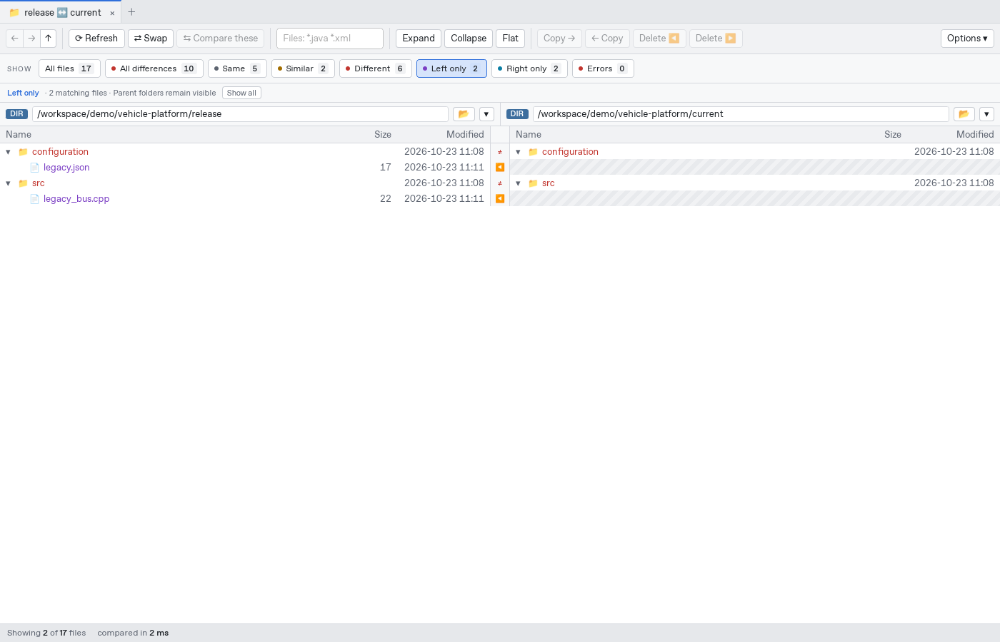
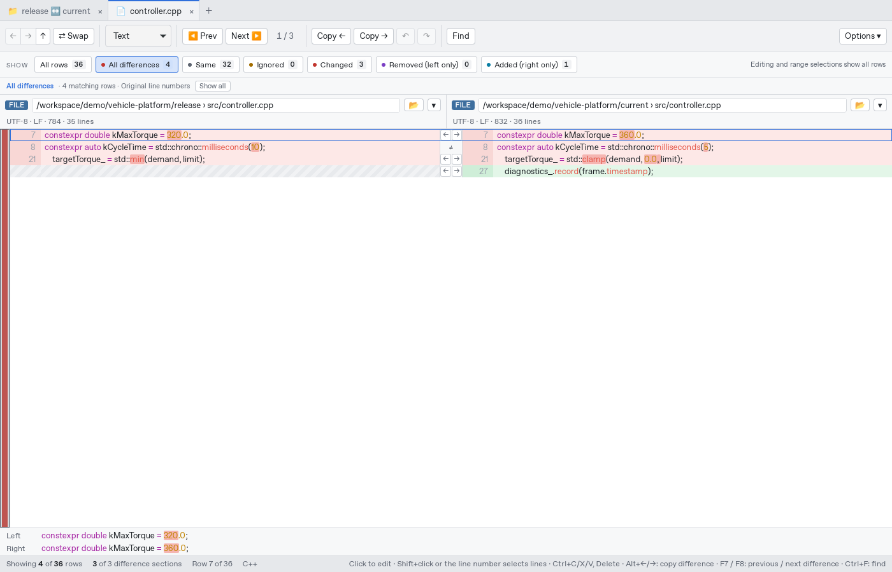
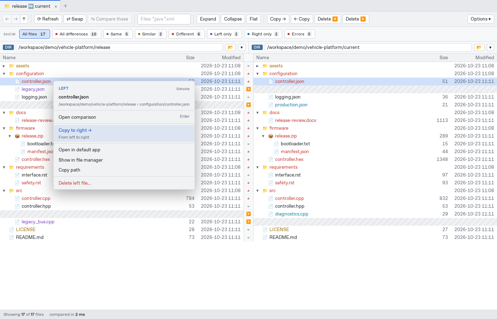
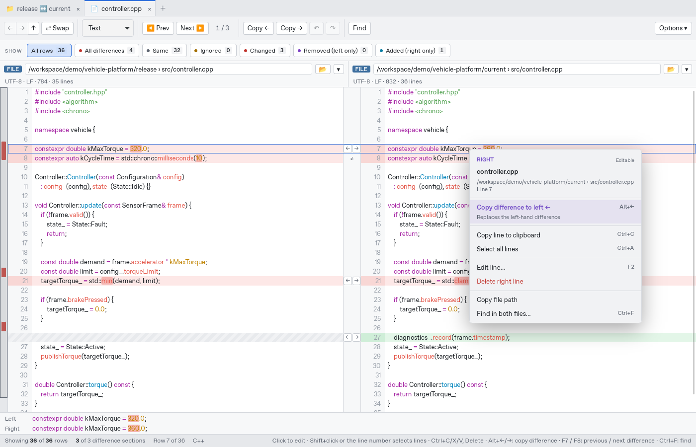
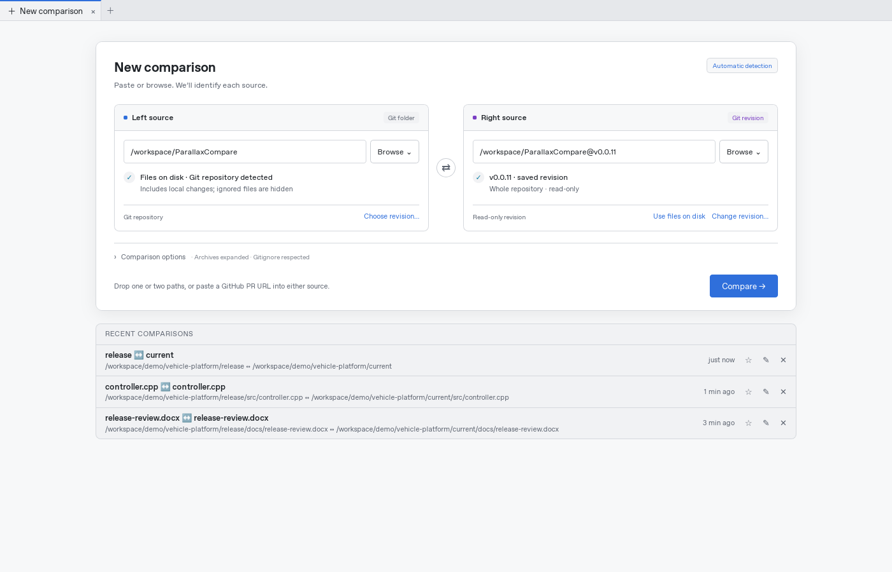

# ParallaxCompare

A fast side-by-side folder and file compare tool for Windows and Linux, in the spirit of Beyond Compare. Folders, archives and Git revisions are all *sources*, and any source can be compared with any other:

- a folder against a folder
- a `.zip` / `.7z` / `.tar.gz` against a folder, or against another archive
- branch `main` against branch `feature/x`, read straight from the repository with no checkout
- a Git revision against the working tree
- archives nested inside folders, inside other archives, or stored in a Git commit, which expand like folders


The design rationale, the GUI mockups and a comparison with existing tools are in [docs/concept.html](docs/concept.html).

## Features

| | |
|---|---|
| **Sources** | Local folders and files · zip and zip-based formats (jar, war, nupkg, vsix, whl, apk …) · 7z · tar, tar.gz, tar.xz, tar.zst, tar.bz2 · Git branches, tags, commits and `HEAD~n` · Git working tree · files ignored by `.gitignore` are compared too and marked *ignored*; *Hide files ignored by Git* (or `--hide-ignored`) leaves them out |
| **Folder compare** | Aligned two-pane tree with missing-side placeholders · clickable count filters: all files, all differences, same, similar, different, left only, right only, errors · **Flat**: all files in one list sorted by name, each with its folder; a file found on only one side each is matched with the file of the same name in the most alike folder, compared and marked ↷, and opening, copying (over its match) and deleting work on the pair · entries show as soon as they are listed and fill in their status (… until compared) while the compare runs · archives inside the compared folders are compared as files (by size, stored CRC32 or bytes) and opened when you expand them, so their contents are compared only on demand · compare by content (default) or by size and date · **≈ similar** status for files whose bytes differ but whose content is equal (CRLF vs LF, re-saved documents with the same text, re-encoded images with the same pixels, Java classes recompiled with only debug info changed) · **file patterns** in the toolbar (`*.java *hello*w*c`): only matching files are compared and shown, folders without any are left out · exclude globs · select several rows (Ctrl/Shift+click) to copy left↔right or delete at once, with progress and Cancel · copying asks first when it replaces files, and names those newer than the copy · deleting moves files to the Recycle Bin / Trash (inside archives it is for good, and the dialog says so) · rows update by themselves when files change on disk |
| **Git** | Compare any two revisions without a checkout · *merge-base* mode shows only what a branch changed since it branched off · identical folders are recognised by their tree id and skipped without being walked |
| **Content views** | Each file type is shown in the form that makes its changes readable, with raw text or a hex dump always one click away. See the table below. |
| **Text compare** | Line diff (Myers, or histogram as an option) with aligned rows and placeholders · changed words marked within each line · clickable count filters for changed, added, removed, same and ignored rows, preserving original line numbers · whitespace and case rules · overview strip · previous/next difference (F7/F8) · find in both files (Ctrl+F; match case, whole words, regular expressions; Enter/F3 for the next match, matches marked in the overview strip) · line-detail pane · encoding (UTF-8/16, legacy code pages) and line-ending detection; when the line endings differ, one click converts either side to the other's · changes in very long lines (minified files) are found and scrolled into view · ≈ similar files open in the view where they are equal, with a note saying why; *Text* still shows every byte difference · binary detection |
| **Editing** | Copy a difference to the other side with the arrows next to it or Alt+←/→ · click into a line to edit it, like in an editor (the caret goes where you click; arrow keys move across lines; Enter splits, Backspace/Delete join, multi-line paste; typing on a selected line edits it from its end) · select lines by clicking the line number, with Shift+click or with Shift+↑/↓ (Ctrl+A all), then Ctrl+C / Ctrl+X to copy or cut them, Delete to remove them, Ctrl+V to replace them; with one line current, Ctrl+V inserts above it · undo/redo (Ctrl+Z/Ctrl+Y) · save a side with the 💾 button next to its "● modified" mark, or all changed sides with Ctrl+S, also into archives; a file another program changed since it was opened is replaced only after asking · the file's encoding, BOM and line endings are kept; files that would not save back byte for byte are not editable · the ECUC values view of ARXML files can be edited and saved as well (written back into the ARXML) · unsaved changes are kept through whitespace and syntax changes, and closing asks first |
| **3-way merge** | Merge two versions of a file against their common base, as a `git mergetool` or for any three files: local, base and remote above the result, which scrolls along · changes on one side are taken automatically, by the same rules as Git, so the result matches `git merge` · per conflict: take local, take remote, take both (either one first), keep the base, or edit the result by hand · undo/redo · save with or without Git's conflict markers · **conflicts of a repository**: the files a merge, rebase, cherry-pick or revert left conflicted, with the branch names; binary and deleted-on-one-side files are resolved as a whole; resolved files are staged on request |
| **Syntax highlighting** | ~190 languages via the syntect grammars bundled with `bat`, plus A2L, DBC, Intel HEX, S-record, Conan files, Xpand, Xtend and Check (oAW) and FreeMarker templates (over HTML for `.ftl`/`.ftlh`, over XML for `.ftlx`, also inside attributes); ARXML, ODX, CDD, MWE workflows and other XML dialects are recognised as XML. Detected by file name, extension or shebang line, with a manual override |
| **CLI** | `parallax` for scripts and CI: tree or unified-diff output, JSON, `diff`-style exit codes |

### Content views

| Files | Default view | What it shows |
|---|---|---|
| S-CORE configuration `.json` | S-CORE configuration | Recognised communication, lifecycle, logging, parameter and FEO shapes: object keys sorted; known collections aligned by unique identities. Process arguments, dependencies, parameter matrices and unknown arrays keep their order. Numbers retain their exact decimal values |
| `.fbs`, `.proto`, `.fidl`, `.fdepl`, `.trlc`, `.rsl` | Definitions | Readable declarations with comments and layout noise removed; TRLC objects and their attributes aligned by identity. Wire fields, enum values, method parameters, model fields and deployment overrides keep their order; FlatBuffers documentation annotations remain visible |
| FlatBuffers `.bin`, `.fb`, `.flatbuffer`, `.flatbuffers` with a schema | FlatBuffers data | Tables, structs, vectors, unions, enums and defaults decoded through a matching `.fbs` or `.bfbs`. Packing differences compare equal; values and the wire-schema fingerprint remain visible. See [schema selection](#flatbuffers-schemas) |
| `.docx` `.xlsx` `.pptx`, `.odt` `.ods` `.odp`, `.pdf` | Document text | Paragraphs (with headers, footers, footnotes, comments); one line per spreadsheet row, cells tab-separated, formulas as `{=…}`; slide text and notes; PDF text per page |
| `.doc` `.xls` `.ppt` | Document text | Read directly in the same form as `.docx` `.xlsx` `.pptx`: Word 97–2003 text with tables, headers, footers, footnotes, endnotes, comments and text boxes; Excel 97–2003 sheets with values and formulas (formulas filled down a range show their values); PowerPoint 97–2003 slide text and notes. Word 6/95 files and anything the readers cannot handle have no text view; they still compare as bytes |
| `.vsdx` `.vsdm` `.vstx` `.vssx`, `.vsd` `.vss` `.vst` | Diagram, Document text | Pages with each shape's text, position and size, outline, shape data, master and the shapes a connector joins, nested shapes indented, other settings as a checksum; then the masters with their shapes, and shapes without text of their own show their master's; the text view lists only the text. Re-saved drawings with the same content are ≈. `.vsd` files of Visio 2000 to 2010 are read directly; Visio 5 and older files have no diagram view |
| Java `.class` files (also inside `.jar`, `.war`, `.ear`) | Class outline | Read directly, no JDK needed; about 0.4 ms per class. **Class outline**: version (with the Java release), declaration with generics, annotations, sealed/record/enum, nested classes, fields with constant values, methods with parameter names and `throws`, each with a checksum and count of its instructions, so a changed method body shows in the outline · **Bytecode**: every method's instructions with references resolved (`invokevirtual java.util.List.size(): int` instead of `#23`), jump targets as labels (`L1`) instead of byte offsets, locals by name, lambdas and string concatenation in short form · **Bytecode with line numbers**. Members are sorted, javac's class-wide lambda numbers are renumbered per method, and line numbers are left out of the plain bytecode view, so recompiling or editing one method does not change the lines of others. Classes whose code is equal apart from debug info (line numbers, local names, source file) are ≈ similar in folder compares |
| WebAssembly `.wasm` modules | Module outline | Read directly with `wasmparser`. **Module outline**: imports, exports, memories, tables, globals, data and element segments, custom sections with sizes, producers, and every function's signature with a checksum and count of its instructions · **WebAssembly text**: every function's instructions with functions, globals and locals by name (name section, else export and import names; Rust names demangled), blocks indented. Functions are sorted by name and checksums hash names instead of indexes, so adding a function does not change other lines. Modules whose sections are equal apart from custom sections (names, producers, DWARF) are ≈ similar |
| .NET assemblies (`.dll`, `.exe` with a CLI header) | Assembly outline | ECMA-335 metadata read directly, no .NET needed. **Assembly outline**: name, version, culture, public key token, references, assembly attributes, every type (C# style declaration with generics, constraints, base and interfaces) with fields, constants, properties, events and methods, each method with a checksum and count of its IL instructions, and the build identity (MVID, PDB path) · **IL**: every method's IL with tokens resolved to names, branch targets as labels, short and long forms folded · **Executable summary** as for native files. Rebuilds that differ only in MVID, timestamp, PDB path or layout are ≈ similar |
| Android binary XML (`AndroidManifest.xml`, `res/**/*.xml` inside `.apk`) | Android XML | Decoded to XML text, one attribute per line, typed values as aapt writes them (`16.0dp`, `#ff0080ff`, `true`), resource references as `@0x7f…` |
| ELF, PE, Mach-O | Executable summary | Header, build id, sections with address, size and CRC32, symbols sorted by name, imports |
| `.dbc` CAN databases | CAN database | Messages sorted by id (hex, standard/extended, DLC, sender, cycle time) with their signals sorted by multiplexer value and start bit (layout, byte order, sign, factor/offset, range, unit, receivers, value descriptions, comments, attributes with enum values resolved), nodes, value tables, attribute definitions, environment variables; unknown statements kept. Same database in another order or number format is ≈ similar |
| `.a2l` (ASAM MCD-2 MC) | A2L objects | Streaming parser, about 14 ms per MB. Every object as a block, sorted by kind and name: positional parameters labelled (address normalized to `0x0001A2B4`, so a rebuild shows as changed `Address:` lines), keywords, `AXIS_DESCR`, reference lists one per line, `IF_DATA` summarized; comments dropped. Same objects in another order or formatting are ≈ similar |
| `.map` linker maps (GNU ld, LLVM lld) | Memory map | Memory regions with use, output sections by address, size by object (total and per section), symbols sorted by name with address, size and object. Other linkers' maps and JSON source maps open as text |
| ELF with DWARF debug info | Debug symbols | After the executable summary: global and static variables with resolved types, size and address, and functions with address range; units read in parallel (112 MB of `.debug_info` in about 1 s) |
| `.mf4` `.mdf` measurements (MDF 4 and 3) | Measurement summary | Only the block tree is read, never the samples: header and metadata, file history, channel groups (cycles, record size, source) with channels (unit, data type, bit position, conversion with tables, source), attachments |
| `.cdfx` calibration data (ASAM CDF 2) | Calibration values | Every instance sorted by name: category, unit, values one per line (`[1][2] = 3.5`), axes, history; revision in the header. Same values in another order or formatting are ≈ similar |
| DCM calibration exports `.dcm` | Calibration values | Scalars, text values, value blocks, curves, maps and axes sorted by calibration name, with units, function/variant metadata and indexed values. Decimal values are normalized without rounding. Comments, object order and line wrapping do not count as differences; unknown statements stay visible and disable the ≈ rule. The `KONSERVIERUNG_FORMAT` header distinguishes calibration data from unrelated `.dcm` files such as DICOM images |
| ODX `.odx`, `.odx-d`, `.odx-c`, `.odx-cs`, `.odx-f`, `.odx-fd`, `.odx-e`, `.odx-v`, `.odx-m` | ODX diagnostics | Diagnostic layers, services, requests/responses, parameters, data types, DTCs, communication settings and vendor extensions as a structural tree. Attributes and named definition collections have a stable order; parameter and other sequence orders are kept. Every XML field remains visible, including IDs and references. Formatting and definition order alone are ≈ similar. References are shown by ID, without resolving inheritance or decoding diagnostic traffic |
| PDX diagnostic packages `.pdx` | Archive tree | Open as ZIP archives, including `index.xml`, ODX descriptions and auxiliary/flash files. ODX entries use the diagnostics view; other files are compared too. A path such as `engine.pdx!/diagnostics/engine.odx-d` opens an individual description directly |
| `.hex` `.s19` `.srec` `.mot` … | Firmware address map | Records decoded into a 16-byte aligned memory map, so different record lengths or order still line up; checksum errors are reported |
| `.png` `.jpg` `.gif` `.bmp` `.webp` `.tif` `.ico` | Image | Side by side, difference overlay or blink; count and bounding box of differing pixels · fitted to the window (small images enlarged, pixels kept sharp), or zoomed with −/+ or Ctrl+wheel, both sides scrolling together |
| `.png` `.jpg` `.webp` `.gif` `.tif`, `.heic` `.avif` | Image metadata (second view; first for HEIF/AVIF) | Read from the file's metadata blocks without decoding pixels: format, dimensions, colour type and bit depth, density, animation; **EXIF** by tag name in groups (image, photo, GPS with the position in decimal degrees, thumbnail) with values as cameras show them (`1/250 s`, `f/2.8`); **XMP** as a sorted list of properties (`dc:title[x-default]`, `dc:subject[2]`), not the XML; **IPTC**; the **ICC profile** (description, class, colour space, version); PNG text chunks and JPEG/GIF comments. Maker notes and other blobs as size and checksum, strip and thumbnail offsets left out |
| `.mp4` `.mov` `.m4a` `.3gp`, `.mkv` `.webm`, `.mp3`, `.flac`, `.ogg` `.opus`, `.wav`, `.aiff`, `.avi` | Media summary | Read from the container headers only (MP4 boxes and Matroska elements are skipped by size, MP3 frames are not walked), so a multi-gigabyte video opens in milliseconds: container and brand, duration, overall bitrate; per track the codec with profile and level, resolution, frame rate, sample rate, channels, language, title, bitrate; tags sorted by name (iTunes `ilst`, Matroska tags per track, ID3v2/ID3v1/APE, Vorbis comments, RIFF INFO, `bext`); chapters; attachments and cover pictures with size and checksum. MP3, FLAC, WAV and AIFF files whose audio is equal and only tags differ are ≈ similar; FLAC files also when the MD5 of the decoded samples is equal |
| `.svg` | Text (XML) | Image view renders it |
| XML/JSON with very long lines | Pretty-printed | Minified files re-indented, one element per line |
| `.gguf` models (llama.cpp, Ollama, LM Studio) | Model summary | Read from the file header only, so a 70 GB model opens as fast as a small one. Views: **Model summary** (architecture, parameters, context length, heads and KV heads, RoPE, tokenizer, file type, bits per weight) · **Chat template** (Jinja source; templates stored as one line are broken at tags) · **Chat template, rendered** (the template applied to sample conversations, including a tool call, so the prompts the model sees are compared rather than the template text) · **Metadata** (every key, sorted) · **Tokenizer** (special tokens, then every token by id) · **Tensors and quantization** (recipe per type, a layer map of types per weight matrix, every tensor with shape, type and size) |
| SQLite databases (`.db` `.sqlite` `.sqlite3` `.db3`, or any name: detected by content) | Database schema | Read directly from the file format, no SQLite library; only the pages a view needs are touched. **Database schema**: header settings, then per table one line per column and table constraint, its indexes and triggers, then the views, sorted by name, SQL with whitespace and comments normalized · **Database rows**: per table the columns and row count, then the rows in rowid or primary-key order, one tuple per line (text over 200 characters and blobs over 32 bytes shortened with a SHA-256), up to 1 000 rows per table and 10 000 in all. Columns added with `ALTER TABLE` show their default in old rows, so an edit shows as the changed rows only. Databases with the same schema and rows are ≈ similar in folder compares (e.g. after `VACUUM`, or another page size or text encoding) |
| Parquet, Arrow IPC / Feather v2 (`.arrow` `.feather`) | Data file summary | Decoded from the footer only (Thrift resp. FlatBuffers, read by hand), so a gigabyte file opens in milliseconds. Parquet: schema with logical types and nesting, rows, key/value metadata, per column codec, sizes and null counts, per row group every column chunk with encodings and min/max statistics decoded by type (dates, timestamps, decimals, strings). Arrow: schema, dictionary encoding, metadata, null counts per field and the record batches. There is no rows view: decoding the compressed data pages would take most of a Parquet implementation |
| `.safetensors` models | Model summary | Read from the JSON header only. **Model summary** (parameters, tensors, layers, bits per weight, data types with their share, `__metadata__`) · **Tensors** (data types, a layer map of dtypes per weight matrix for `….layers.N.…` names, every tensor in natural order with shape, dtype, size and, for tensor data up to 256 MiB, a CRC32). Files with the same tensors and only other `__metadata__` are ≈ similar (checked up to 4 GiB of tensor data) |
| `.onnx` models | Model graph | Protobuf decoded by hand. IR version, producer, opsets, metadata props, inputs and outputs with element types and (symbolic) shapes, initializers sorted by name with dtype, shape, size and CRC32 (tiny ones with their values), every node in graph order as `Op(inputs) -> outputs {attributes}  // name`, with If/Loop bodies indented below their node, functions and value infos |
| Jupyter `.ipynb` | Notebook | **Notebook**: each cell's type and source, outputs in short form (stream text, `text/plain` results, errors as one line, images and HTML as `[image/png 12 KB, crc …]`); execution counts, ids and metadata left out · **Notebook, code only**. Notebooks with the same cells are ≈ similar |
| Lockfiles: `package-lock.json`, `npm-shrinkwrap.json`, `yarn.lock` (v1, Berry), `pnpm-lock.yaml`, `Cargo.lock`, `poetry.lock`, `uv.lock`, `Pipfile.lock`, `composer.lock`, `Gemfile.lock`, `go.sum`, Conan `conan.lock` (Conan 2 and 1) | Dependencies | One line per package and version, sorted and deduplicated, with the source only when it is not the default registry; Conan packages with their recipe revision (and package id for Conan 1), tool, Python and config requirements marked, timestamps dropped; ≈ similar when the packages and versions are the same |
| reStructuredText `.rst` `.rest` | Text (reST highlighting) | **Text, reflowed**: each paragraph and list item on one line, heading underlines as long as the title, literal blocks, code, tables and directive options kept as they are; files that differ only in wrapping are ≈ similar · **Needs** (when the file has [Sphinx-Needs](https://sphinx-needs.readthedocs.io)): every need sorted by id, options in a fixed order, link and tag lists sorted, text reflowed, nested needs listed with their parent, `needextend` at the end; needs of the default types and any directive with an `:id:` count. Files with the same needs in another order are ≈ similar |
| Sphinx-Needs `needs.json` | Needs | The same per-need form as for reST, per version, without empty defaults, line numbers, timestamps and the tool version; two builds of the same sources are ≈ similar |
| FreeMarker `.ftl` `.ftlh` `.ftlx` | Text (FreeMarker over HTML or XML) | **Template outline**: the directives (`<#if>`, `<#list>`, `<#macro>` …), user-defined directive calls (`<@ui.card>`) and `${…}` interpolations without the markup, indented by nesting, `<#else>` level with its directive; both tag syntaxes, `<#…>` and `[#…]`. Templates that differ only in `<#-- … -->` comments are ≈ similar. Mozilla Fluent files, which share `.ftl`, stay plain text |
| AUTOSAR EcucValues `.arxml` (files with ECUC module configuration values) | ECUC values | **ECUC values**: simplified JSON. Each module is an object with its `@def` and `@variant`. Inside it, parameters and references are keyed by the last segment of their definition, and sub-containers are grouped by definition and keyed by short name (`@index` where the file has one). Keys are sorted; numbers are decimal (`0x1F` → `31`, octal and binary too) and booleans are `true`/`false` (`1`/`0` too); references are written `"→ Mcu/McuModuleConfiguration/Clk"` without the package of the file's modules, and instance references as `"→ context ▸ target"`. UUIDs and admin data are left out. Files that differ only in order, UUIDs, admin data, number spelling or package name are ≈ similar. **Editable**: copy differences between the sides or edit by hand, then save. The ARXML is patched in place: only the values, containers and modules that changed are rewritten, everything else keeps its bytes, and numbers keep their style (hex stays hex, `1`/`0` booleans stay `1`/`0`). A new parameter or container is written like the same definition in the file or in the file on the other side, with its full definition path and `DEST`. Commas are optional, so copied lines never break the syntax. Before writing, the result is read back and must give exactly the edited text; a syntax error or an unknown parameter is reported with its line and nothing is saved. Checked on 23 real EcucValues files and 300 pairs generated from the AUTOSAR module definitions: 2 196 copies and edits written, all valid against the AUTOSAR 4.4 schema and, for whole files, equal to the source in every definition path, `DEST` and value by an independent reader. A 28 MB file saves in 2.5 s |
| Xpand templates `.xpt` (openArchitectureWare, Eclipse M2T) | Text (Xpand highlighting) | **Template outline**: `«IMPORT»` and `«EXTENSION»` sorted, then every `«DEFINE»` and `«AROUND»` sorted by name with a checksum of its body and the `«FILE»` and `«EXPAND»` statements it contains. Templates that differ only in `«REM»` comments, `//` and `/* */` comments inside statements, spacing inside `«…»`, the quotes of strings or text outside definitions (which Xpand never writes) are ≈ similar; spacing in the output text and `-»` still count. ISO-8859-1 templates keep their guillemets. Checked against the Xpand 2.2 parser on 12 600 mutants of the templates, extensions and checks shipped with Xpand 2.2, the Xtext 2.8 generator and GMF: no wrong ≈, none missed |
| Xtend extensions `.ext`, Check constraints `.chk` | Text (Xtend/Check highlighting) | **Code outline**: imports sorted; extensions with their signature and a checksum of the body (`JAVA` extensions in full); checks as `context Type if … ERROR "…"` with a checksum of the constraint, sorted. Comments and layout do not count. Workflows `.mwe` and `.oaw` are XML (Pretty-printed XML view). SAS `.xpt` transport files and CHKDSK `.chk` fragments stay binary |
| Rust `.rs` | Text | **Code outline**: per module the `use` declarations, constants, structs and enums with their fields and variants, traits and `impl` blocks with their members, functions with signature and a checksum of the body, and macros, sorted by kind and name; attributes shown, doc comments not. Compared by tokens without comments (doc comments too), so what rustfmt changes is ≈ similar: layout, trailing commas (not that of a 1-tuple), the order of `use`/`mod`/`extern crate` items and of names in `use` braces, commas between match arms and the braces around a single-expression arm or closure body, `;` after `return`/`break`/`continue` at the end of a block and after block-like statements, `>>` versus `> >`, `extern` versus `extern "C"`, nested parentheses; inside `macro_rules!` every token counts. Checked on 2 500 files from 699 crates: all 752 that rustfmt changes are similar (2 differ only inside `macro_rules!`), and 31 000 mutants judged by `syn`'s syntax tree gave no wrong ≈ outside trailing commas and doc comments in macro arguments, which count as formatting by design |
| JavaScript `.js` `.mjs` `.cjs` `.jsx`, TypeScript `.ts` `.mts` `.cts` `.tsx` `.d.ts`, `node` scripts | Text | **Code outline**: imports (sorted), interfaces, types and enums with their members, classes with constructor, fields and methods, functions and function-valued variables with signature and a checksum of the body, other variables; other code in one checksum. Compared by tokens with semicolons inserted where JavaScript inserts them itself, strings and numbers by value and JSX text as React reads it, so what Prettier changes is ≈ similar: layout, semicolons, quotes, trailing commas (not array holes), parentheses that precedence makes redundant (`(a && b) \|\| c`) or that wrap a value, a JSX element or a single arrow parameter, `new Foo` versus `new Foo()`, quoted object keys, `,` versus `;` between interface and type members, a leading `\|` in unions, `{" "}` in JSX and `attr={"x"}`. Checked on 2 540 files: 98 % of what Prettier rewrites is similar, all 138 TSX files; 68 600 mutants judged by the TypeScript compiler's syntax tree gave no wrong ≈. Files over 16 MB are compared by bytes |
| Python `.py` `.pyi` `.pyw`, scripts with a `python` shebang | Text | **Code outline**: the module docstring, imports (sorted), module and class level assignments, classes with their members, and every function with its signature and a checksum of its body (`# code 1a2b3c4d, 57 tokens`), sorted by name, so moving a function changes nothing and editing one changes its line; other module code in one checksum. Built from tokens with formatting removed, so files that differ only in comments, blank lines, line breaks, indentation width, quote style, re-indented docstrings, trailing commas and the parentheses Black adds or removes are ≈ similar. Checked against Python's `tokenize` on 1 982 files (identical tokens), on 1 166 files and their Black output (all similar but one, where Black changes the meaning of `(x): int`), and against 19 000 mutants judged by Python's AST (no wrong ≈) |
| Perl `.pl` `.pm` `.t` `.psgi`, scripts with a `perl` shebang | Text | **Code outline**: per package the modules used (sorted), `our` variables and constants, subs and `BEGIN`/`END` blocks with prototype or signature and a checksum of the body, sorted by name; other code in one checksum, `__END__`/`__DATA__` as a checksum. The lexer knows Perl's quoting (`q qq qw qx m qr s tr y` with any delimiters, here-documents, `<FH>`), regex versus division and `%hash` versus modulo; files that differ only in comments, POD, layout, the quotes of strings that interpolate nothing, a trailing comma or the last semicolon of a block are ≈ similar. Checked against B::Deparse on 27 500 mutants of 2 095 Perl files (spaces, line breaks, comments and POD inserted at random places, including inside strings, regexes and here-documents): no wrong ≈ |
| Conan graph JSON (`conan graph info`, `install`, `create` with `--format=json`) | Conan graph | Every package by reference and context with package type, package id, package revision, binary status, settings, options and direct requirements (requires, tool requires, test requires) by full reference; resolved version ranges and overrides; no paths, timestamps, recipe metadata or node numbers. Graphs that differ only in those, in binary status (cache, download, build) or remotes are ≈ similar; in the folder compare for `graph.json`, `install.json`, `create.json`, `build.json`, `deps.json` and `conan*.json` |
| Conan `conanfile.txt`, profiles, `conaninfo.txt`, `conanbuildinfo.txt` | Text (Conan highlighting) | **Normalized**: comments, blank lines and spacing around `=` dropped, sections in alphabetical order with repeated ones merged, generators sorted; other entries keep their order, since later ones override or append; profiles with Jinja keep their section order. Same entries are ≈ similar. Profiles (no extension) are recognised by an `include()` or a Conan section as the first entry. `conanmanifest.txt` that differs only in its time line is ≈ similar; `conanfile.py` is highlighted as Python and `conandata.yml` gets the YAML views |
| `.yaml` `.yml`, `.toml` | Text | **Normalized YAML/TOML**: keys sorted recursively, one layout, comments dropped, anchors and merge keys expanded, duplicate keys reported; files with the same data are ≈ similar |
| `.csv` `.tsv` | Text | **Table, sorted by key**: delimiter sniffed, quoted fields, rows sorted by the first unique column, cells joined by ` │ ` without padding (first 200 000 rows); same rows in another order are ≈ similar |
| Certificates and keys: PEM, DER (`.cer` `.crt` `.der`), PKCS#12 (`.p12` `.pfx`) | Certificate | Subject, issuer, serial, validity, key type and size, signature algorithm, SANs, key usages, basic constraints, key ids, SHA-256 fingerprint; CSRs and CRLs; keys by type and size only. PKCS#12 contents encrypted with PBES2 are opened with the empty password. The same certificates as PEM and DER are ≈ similar |
| E-mails `.eml`, Outlook `.msg` | E-mail | From, To, Cc, Subject, Date, Message-ID, In-Reply-To; the body as text (HTML converted when there is no plain part); attachments with type, size and SHA-256. Messages differing only in transport headers or encoding are ≈ similar |
| Other binary files | Hex dump | Up to 16 MB |


### FlatBuffers schemas

For automatic decoding, put a schema with the same stem beside each binary: `config.bin` with `config.bfbs` or `config.fbs` (`.bfbs` takes precedence). Each side uses its own schema, including schemas and relative includes inside archives and Git revisions. In a file comparison, **Schemas** lets you choose a local schema for both sides or a different schema for each side.

The CLI also accepts explicit local schemas:

```sh
parallax old.bin new.bin --schema config.bfbs
parallax old.bin new.bin --left-schema old.fbs --right-schema new.fbs
```

Binary reflection schemas (`.bfbs`) are read directly. Text schemas (`.fbs`) need the FlatBuffers compiler **`flatc` on PATH**; tested with 24.3.25. Compilation runs in a temporary directory, preserves the source files and caches the result. No compiler is needed for the `.fbs` Definitions view. Schemas need a `root_type` to decode data. An ordinary buffer or a buffer with a size prefix is accepted; a file identifier is checked when the schema specifies one.

These structured views are read-only; Text and Hex remain available. Missing tools, malformed buffers, missing includes, identifier mismatches and populated fields absent from the schema produce an error (the desktop app falls back to a raw view with the reason). Folder comparisons only report ≈ when decoding succeeds on both sides. FlatBuffers buffers have no general schema identity, so a matching schema is still your responsibility. Advanced 64-bit offsets/vectors and reflection schemas with vector/string defaults are currently rejected. Decoding is limited to 64 MiB of binary data and 16 MiB of schemas/includes.

S-CORE JSON recognition follows the supported configuration shapes rather than treating every JSON file as a S-CORE configuration. Definitions views preserve tokens and meaningful order, but do not replace the TRLC, Franca, Protobuf or FlatBuffers validators.

## Writing to archives

Copy and delete work inside zip, 7z and tar archives, including archives nested in other archives; Git revisions are read-only. Each operation rewrites the archive once: the new archive is written to a temporary file next to the old one and then renamed over it, so a failed write leaves the old archive intact.

- **zip:** unchanged entries are copied as stored, without recompressing. A change to a 60 MB zip with 23 000 files takes 0.2–0.3 s.
- **7z:** unchanged blocks are copied as stored, so adding files is quick (about 1 s for a 27 MB archive). Replacing or deleting a file in a *solid* block means decompressing that block and compressing the rest of it again, as 7-Zip does: about 22 s on 4 cores for a block holding 247 MB.
- **tar, .tar.gz, .tar.xz, .tar.bz2, .tar.zst:** the whole archive is compressed again.

Copying an archive row (or a parent folder containing it) copies the **whole archive**, including entries hidden by filename patterns, exclusions or status filters. The confirmation names these archives explicitly. A filtered parent-folder copy includes an archive when its name or an entry inside it matches; archives with no matches are skipped. To copy individual entries instead, select those entries inside the expanded archive. Before rewriting an archive, the current container is reopened so unrelated edits made in another tab or program are preserved.

New entries are compressed with deflate (zip) or LZMA2 at 7-Zip's default level (7z, .tar.xz). File permissions are not carried over: new tar entries get mode 644 (folders 755).

## Watching for changes

Local folders, archives and files are watched while they are compared. A change outside the app updates only the rows it affects: a changed file is compared again on its own, a new file is inserted into its folder, and a burst of changes (a build, a checkout) is collected for a moment and merged into the few folders it touched, or one full compare when it reaches the top. A file open in a text tab is reloaded, or, with unsaved edits, a banner offers to reload it. Excluded folders and the app's own writes do not count.

On Linux, where each folder needs its own watch, only the folders the compare shows are watched: folders ignored by `.gitignore` (`target/`, `node_modules/` …) and excluded folders are left out (an ignored folder is read when compared, not watched), and new folders are added as they appear. Watching the 3 500 folders of the test tree takes about 0.15 s, in the background; 5 000 files written in 0.15 s arrive as one update 0.35 s later.

## Performance

All of the work happens in a multi-threaded Rust core; the UI only renders the rows that are visible.

- **Git vs. Git:** tree ids are compared before anything is read. An unchanged folder costs a single id comparison, however large it is; selective filename patterns walk its metadata to find matches. Changed files are decided by their blob ids, without inflating the objects.
- **Archives:** in the app, an archive inside a compared folder is first compared as a file: archives of different size, or with different CRC32 in an outer archive, are different, and others are compared byte for byte. Its entries are compared when it is expanded (Expand and Flat open all of them); the CLI compares archive contents right away. Local archives use buffered, seekable file readers on Linux and Windows, without copying the whole container into memory. ZIP indexing reads its central directory; 7z indexing reads its headers. Container metadata is resolved once per comparison rather than once per member. Compressed tar streams still need to be decompressed while indexing. zip and 7z entries are compared with the CRC32 stored in the archive headers, so nothing is decompressed for listing or for entries with equal CRC32 and size. Differing zip entries are decompressed only up to their first difference. Different data has the same CRC32 only by a one-in-four-billion chance or when made to; *Verify archive entries byte for byte* under Options (`--verify-archives` in the CLI) decompresses such entries and compares them. That costs time: two copies of a 69 MB solid 7z with 223 MB of files take 3 s instead of 0.1 s.
- **Git vs. local file:** the local file's Git blob id is computed and compared, instead of reading the Git object.
- **Local files:** parallel walking (rayon), files are memory-mapped, and a comparison stops at the first differing byte, so differing files are read only that far. Different sizes settle it without reading at all when no rule can make the files equal anyway (line endings, or a content rule for the file type).
- **Text views:** rows, intra-line marks and syntax colours are produced only for the visible window. Highlighter state is checkpointed every 128 lines, so jumping to line 900 000 does not re-parse the file from the top.

Measured with the CLI on two Linux kernel releases (v6.11 and v6.12, ~87 000 files, 1.6 GB per tree). The machine is a 4-core cloud VM, the OS file cache was warm, and each time is the full wall-clock run including output:

| Comparison | 1 thread | 4 threads |
|---|---|---|
| Git tag vs. Git tag (read from the object database) | 1.9 s | 0.51 s |
| Folder vs. folder, by content | 2.0 s | 0.59 s |
| Folder vs. folder, nearly identical (all 1.6 GB read) | 1.8 s | 0.58 s |
| Folder vs. folder, quick (size and date) | 0.62 s | 0.23 s |
| Worktree vs. `HEAD` (one file edited) | 2.2 s | 0.69 s |
| Text diff, 1 million lines (55 MB), 2 500 changed lines | 0.41 s | — |

Archives, measured with `cargo bench -p parallax-core --bench archives` (same machine, 200 MB of content per zip, median of 5 compares, peak memory of the process):

| Two zips | Time | Peak memory |
|---|---|---|
| Identical, 100 stored binary files | 1.2 ms | 20 MB |
| 200 text files, each changed near its start | 8.4 ms | 49 MB |
| 200 text files, each changed near its end | 145 ms | 101 MB |
| 200 text files, LF vs CRLF (≈ similar) | 193 ms | 102 MB |

Opening files with the content views (same machine): a 12 MB ARXML (242 000 lines) diffs in about 35 ms, and highlighting anywhere in it takes under 10 ms. A 5 MB Latin-1 A2L with 10 000 changed lines diffs in 0.1 s; with histogram instead of Myers it takes 0.9 s, which is why Myers is the default. A 300-page PDF extracts in 0.18 s, and a 100 000-row XLSX in 0.2 s.

In the desktop app (release build, same kind of VM), two 1-million-line files (63 MB each) are on screen about 2 seconds after start, and two 3-million-line files (200 MB each) after about 4. Jumping anywhere, with F7/F8, Home/End or the overview strip, shows the rows within 0.1 s. While the scrollbar is dragged, rows not loaded yet show as grey bars and fill in when it stops. Views taller than a browser can lay out (WebKit stops painting past about 16.7 million pixels, or 880 000 lines) scroll through a scaled scroll area, so the end of any file stays reachable.

Folder compares use every core: with 4 threads they run 3.5–3.8× faster, at about 370 % CPU. A text diff of a single file runs on one core; the desktop app only renders and highlights the visible rows.

## Usage

### Desktop app

Start `parallax-compare` and paste or browse for the two sources in the *New comparison* dialog. Files, folders, archives and Git revision syntax are detected automatically. A repository folder starts with its files on disk; **Choose revision…** selects a branch, tag or commit, with an optional file or subfolder. A bare revision such as `main` asks for its repository. Access errors stay beside the input, and known file/folder mismatches are blocked before comparing. You can also pass both sides on the command line:

```sh
parallax-compare ~/src/shop@main ~/src/shop@feature/checkout --merge-base
parallax-compare dist/ release-1.4.7z
parallax-compare old.txt new.txt
```

As a Git difftool:

```sh
git config --global difftool.parallax.cmd 'parallax-compare "$LOCAL" "$REMOTE"'
git config --global diff.tool parallax
git difftool --dir-diff main feature/x     # or simply: parallax-compare .@main .@feature/x
```

### Merging and Git conflicts

As a Git mergetool:

```sh
git config --global mergetool.parallax.cmd 'parallax-compare --merge "$BASE" "$LOCAL" "$REMOTE" --output "$MERGED"'
git config --global mergetool.parallax.trustExitCode true
git config --global merge.tool parallax
git mergetool
```

The merge view shows local, base and remote side by side, with the result below them; drag the bar between them to share the height. Lines are tinted by where they come from (local, remote, the same change on both, edited), and changed characters are marked against the base. Everything that changed on one side only is merged already, by the rules `git merge` uses, so the result starts out as Git's file with its conflict markers, and the markers use the branch names Git uses. Each conflict has a bar above it in the result:

- **Take local**, **Take remote** (Alt+← / Alt+→), **Take both** (Alt+↓, local first), **Both, remote first** (Alt+Shift+↓), **Keep base** (Alt+↑)
- click any line of the result to edit it, as in the file comparison (Enter splits a line, Backspace/Delete join lines, multi-line paste); a conflict edited by hand counts as resolved
- **Undo choice** puts a conflict's markers back; Ctrl+Z / Ctrl+Y undo and redo any change
- F7/F8 go to the previous/next conflict; after a choice, the next open conflict is selected

**Save result** (Ctrl+S) writes the file. With conflicts left, it asks whether to save with Git's conflict markers, so you can finish later. Under `git mergetool` the window has a **Close** button: the exit status tells Git whether the merge is done (the result was saved without conflicts) or not, so Git keeps the file marked as conflicted. If the file in the work tree is not what the merge gives (a merge driver or `git rerere` resolved more), **Start from Git's result** loads it instead. `merge.conflictStyle` (`diff3`, `zdiff3`) is respected.

**Conflicts of a repository:** `parallax-compare .` in a repository with conflicts, or *Resolve conflicts in a repository…* in *New comparison*, lists the conflicted files with what went on (*Merging feature/x into main*, *Rebasing …*, *Cherry-picking …*, *Reverting …*) and which branch is local and which is remote; in a rebase, local is the branch being rebased onto. Text files open in the merge view; saving one without conflicts marks it resolved. **Keep local** and **Take remote** resolve any file as a whole, also binary files and files deleted on one side (then the choice is to keep or delete it). Nothing is staged until **Stage resolved files** runs `git add` (or `git rm`) for the files resolved here; then continue with `git commit`, `git rebase --continue` and so on.

**Syntax-aware merging:** where lines conflict, the merge view also merges by the syntax of the file and offers the solutions it finds: struct fields, imports, functions or JSON keys both sides added at the same place, a function moved on one side and edited on the other. The engine is chosen under **✦ Syntax-aware** in the toolbar:

- **Built in** (the default): [weave](https://github.com/Ataraxy-Labs/weave), which merges functions, classes and keys as units (weave lists 38 languages and formats, among them JSON, YAML and TOML). It runs inside the app in milliseconds. Files it cannot parse into such units keep the line merge
- **mergiraf**: [mergiraf](https://mergiraf.org), when installed separately (`cargo install mergiraf`, or your system's package; GPL-3.0, so it is run as its own program and never bundled). It merges syntax trees node by node and also solves changes to different arguments on the same line. Found through the path given there, `PARALLAX_MERGIRAF` or `PATH`; it gets 5 seconds per file
- **Off**: lines only, as Git merges

Solutions are offered, never applied by themselves:

- a conflict the engine solves gets **✦ Syntax-aware** (Alt+S) on its bar, with the solution in the tooltip; **✦ Apply N solutions** in the toolbar takes all of them. Taken solutions are tinted green in the result; undo works as for any choice
- where Git's line merge joined two conflicts and the engine solves one, **✦ Narrow down** replaces the conflict by the smaller one left
- where the engine finds a conflict the line merge did not (the same key added on both sides), or merges the file differently also outside the conflicts, a banner offers its whole result
- in the list of a repository's conflicts, files the engine solves completely are marked **✦ solvable by syntax**; **✦ Solve** writes the result into the work tree (not staged) and marks the file for review

*Merge three files…* in *New comparison* merges any three files (the base is optional; without it every difference is a conflict) into a result file of your choice.

To compare against something else without starting over, change a side from its path bar above the panes:

- click the path, type another one (any form from the table below, e.g. `repo@v1.4`) and press Enter; Esc cancels. While typing, recently compared paths and the entries of the folder typed so far are suggested: Tab completes (after `repo@`, branch and tag names), ↑/↓ choose. Archives are marked **ARC**; Tab on one enters it (`app.zip!/`) and completes its entries, also of archives inside it. Zip, jar and 7z files are listed from their index; a compressed tar is read once, with "Reading …" shown while it takes
- on a side inside a Git repository, the **version chip** (`⎇ working tree ▾`, or Alt+V for the active side) switches it to another version of the same folder or file: the working tree, the **staged** files, HEAD, the **upstream** branch (with when it was last fetched, and **Fetch**), other branches, tags, the commits that changed a file, the other side's version or the merge base with it, or any revision typed in (`a41c9e2`, `HEAD~3`). Shift+Enter switches both sides. Open folders, the selection, filters and the scroll position stay, and Back returns to the previous version
- in a file comparison, the buttons under each path switch a side in a repository to **Working tree**, **Staged**, **HEAD** or its upstream branch in one click (Shift+click: both sides). When a file with uncommitted changes is compared with something else, the status bar offers **Compare with HEAD** (Alt+H). In a folder comparison, a file's menu has *Compare with HEAD* and *Compare with* its upstream branch
- 📂 opens the file or folder dialog (⎇ the branch list for a Git side)
- ▾ opens a menu: *Change side…* (a path or repository link, detected automatically), *Git history of this file…* (pick the working tree or any commit that changed the file for this side), *Open in default app*, *Show in file manager*, *Copy path*
- drop a file or folder from your file manager onto the left or right half of the window; drop two to replace both sides, or onto a *New comparison* tab to fill it in and review the detected sources before pressing Compare

The tab keeps its options and the other side, and the view stays as it was. If the new path cannot be opened, the old comparison stays. Comparing the working tree with a revision reads only the files that changed: a file whose size, time and inode still match the Git index is known to hold the blob recorded there, as `git status` assumes too. In a file opened from a folder comparison, changing one side compares that file with any other file, also one with a different name.

Each tab remembers what it compared before: ← and → in the toolbar (or the mouse's back and forward buttons) go back and forth, and ↑ goes one level up: from a file opened in a folder comparison back to that row, otherwise to both sides' parent folders. To compare two different rows of a folder comparison, such as a file renamed between the sides, Ctrl+click both and choose *Compare these*. *Swap* exchanges left and right, in folder and file comparisons.

Right-click a folder-comparison entry for actions on the clicked side. The menu names the side and source: copy goes to the opposite pane, while delete, open, reveal and copy path apply to the clicked pane. Bulk actions show how many selected items exist on that side. A missing entry offers to copy the opposite entry here; read-only destinations and deletion on read-only sources are disabled with a reason. Folder entries can become the base folder of their side or both sides (Back returns). Open comparison and Compare these two remain shared actions. Shift+F10 opens the menu for the last active pane.

In a file comparison, right-click text or a line number to copy text/lines, copy the clicked difference to the opposite side, edit or delete lines, copy the file path, or find in both files. Right-clicking within a line selection preserves it. Edits use the usual undo history and stay unsaved until Save; read-only views disable editing commands. The active line editor keeps its native text menu. Shift+F10 opens the menu for the active pane and line; arrows, Home/End, Enter and Escape navigate it.

Settings that change less often (compare rule, line endings, excluded files; whitespace, case, diff algorithm, syntax) are under *Options* at the right of the toolbar; a dot there means they differ from the defaults.

**Command palette:** Ctrl+Shift+P, Ctrl+K or F1 lists every action of the app and the current tab, with its shortcut. Type a few letters (in order is enough, e.g. `expall` for *Expand all folders*) and press Enter.

The *New comparison* tab lists recent comparisons: click one to compare again with the same options, ☆ pins it to the top, ✎ puts it into the form to change it first. Errors and confirmations appear briefly in the lower right corner.

Filename patterns accept spaces, commas or semicolons between globs. Brace alternatives such as `*.{java,kt}` and character classes stay together. Quote literal filenames containing separators, for example `"report final.txt"` or `"report,final.txt"`. `?` matches one Unicode character and include patterns ignore Unicode case. Exclusions under Options are case sensitive and comma separated; braces and quoted names work there too. Live updates use the same patterns as a full comparison.

The count strip above the comparison doubles as its status filter. In folders, choose *Different* for changed files present on both sides, *Left only* or *Right only* for files on just one side, or *All differences* for all three plus errors. *Same* and *Similar* are separate filters. Matching parent folders stay visible and are opened when selecting a filter. Totals stay fixed for the current comparison; the footer shows how many files match, including files in collapsed folders. In Flat view, totals count matched moved files once and update as their comparisons finish. Git folders skipped as identical contribute their files once loaded.

File views use the same strip for *Changed*, *Added (right only)*, *Removed (left only)*, *Same*, and *Ignored* (differences only in ignored whitespace or case). Counts refer to aligned comparison rows. Filtering preserves original line numbers and F7/F8 navigates only matching difference sections. Editing, copying a whole difference, and range selections restore all rows for full context. Find searches both whole files and restores all rows if a match was hidden. *All files* / *All rows* resets the status filter; filename patterns and comparison options keep their own settings.

<details>
<summary>Screenshots: count filters, context menus and comparison setup</summary>

Clicking **Left only** keeps the matching files and their parent folders visible. The counts stay fixed, and **Show all** resets the status filter.



**All differences** in a file comparison shows changed and one-sided rows with their original line numbers.



Folder context menus identify the clicked side and source, with copy directed toward the other side.



File context menus identify the clicked side and line, including copy, edit and delete actions.



Paste or browse for each source. Detected-type badges confirm files, folders and archives; Git folders offer a contextual revision chooser. Comparison options are collapsed, and merge base is offered for two Git revisions.



</details>

Keyboard: arrow keys, Enter (open or expand), ←/→ (collapse/expand), F5 (refresh), F7/F8 (previous/next difference), Ctrl+F (find), F3/Shift+F3 (next/previous match), Ctrl+Shift+P / Ctrl+K / F1 (command palette), Shift+F10 (context menu), Ctrl+T (new tab), Ctrl+W (close tab), Ctrl+Tab / Ctrl+Shift+Tab (next/previous tab), Ctrl+1…8 (that tab), Ctrl+9 (last tab), Ctrl+Shift+PageUp/PageDown (move the tab). Tabs can be dragged to another place. With many tabs, the tab bar scrolls with the mouse wheel.

### Source syntax (CLI and path fields)

| Text | Meaning |
|---|---|
| `path/to/folder`, `file.txt` | a local folder or file |
| `release.7z` | an archive, compared as a folder |
| `release.7z!/bin` | a folder inside an archive |
| `repo@main`, `repo@v1.4.0`, `repo@HEAD~3` | a Git revision of the repository at `repo` |
| `repo@main:src/lib` | a folder (or file) inside a Git revision |
| `https://github.com/o/r/blob/main/src/lib.rs`, `…/tree/v1.4/src` | a file or folder on GitHub, GitLab (`/-/blob/…`), Bitbucket (`/src/…`), Gitea/Codeberg (`/src/branch/…`), or `raw.githubusercontent.com` |
| `https://host/o/r.git@v1.4:src`, `git@host:o/r.git@main` | a revision of a remote repository by its clone URL |

Remote repositories are read through the installed `git`, so its credential helpers, SSH keys and proxy settings apply (private repositories work as with `git clone`). Only the commit compared is fetched (`git fetch --depth 1`), into a cache folder (`ParallaxCompare/remotes` in the user's cache folder, or `PARALLAX_CACHE`); a branch is fetched again each time it is opened, a commit id only once. Branch names with `/` in web links are looked up on the remote.

Paste a **GitHub pull request URL** such as `https://github.com/owner/repo/pull/123` into either path in **New comparison**, then choose **Resolve PR** to preview its merge base and head, followed by **Compare PR**. The PR supplies both sides; **Back to two sources** restores your previous pair. A PR URL pasted into an open comparison's path bar replaces both sides too. The left side is the PR's **merge base**, the right side its **head**, both read-only. Links to the PR's Files changed or Commits tabs also work. GitHub Enterprise hosts such as `https://github.company.example/team/project/pull/123` use the hostname in the URL.

PRs need the installed **GitHub CLI (`gh`) and Git (`git`)** on the application's PATH. Authenticate beforehand with `gh auth login --hostname HOST`. The app uses `gh` for metadata and the merge base, and Git for file contents, respecting the host's `gh config` Git protocol (`https` or `ssh`). HTTPS fetches need a Git credential helper (for example `gh auth setup-git --hostname HOST`); SSH fetches use existing SSH credentials. Proxy and corporate certificate settings must work for both tools. Access failures are shown with the host/repository and authentication guidance; the app does not change your authentication configuration or check out a branch.

Remote repository links are resolved on Compare; PR access is checked only on Resolve PR.

An opened PR is pinned to exact commit IDs, including when the target branch advances or the PR is force-pushed. Recent comparisons reopen that snapshot, and Refresh compares the same snapshot again. Paste the PR URL again (or edit its recent entry) to resolve the current PR. All normal file and archive views remain available. Git LFS files remain their Git pointer files and submodules remain commit references; their external contents are not downloaded.

A text that names an existing path is always read as a path, so folders with `@` in their name keep working.

### CLI

```console
$ parallax ~/src/shop@main ~/src/shop@feature/checkout
  ≠ assets/
  ≠ assets/fonts.zip/
  ≠ assets/fonts.zip/Inter-Bold.woff2
  → assets/fonts.zip/Inter-Italic.woff2
  ≠ src/
  ≠ src/checkout/
  ≠ src/checkout/cart.ts
  → src/checkout/discount.ts
  ← src/checkout/legacyPayment.ts
  ≠ src/checkout/types.ts
  ≠ package.json

9 files compared: 2 same, 4 different, 1 left only, 2 right only  (1 ms, 1 identical folders skipped via Git tree ids)
```

Files are compared through their content view, so `parallax old.docx new.docx` prints a diff of the document text, and two images report their differing pixels. `--raw` compares the plain bytes as text instead, and `--bytes` turns off the ≈ similar status in folder compares.

`parallax merge BASE LOCAL REMOTE [-o OUT]` merges three versions of a file without a window, like `git merge-file`, and writes the result with conflict markers where needed (to standard output without `-o`). The sources can be any of the forms above, such as `repo@main:src/a.c`. `--style diff3|zdiff3` adds the base to the markers, `-L` sets the labels, `--level` chooses how hard to make conflicts small. `--strategy syntax` also merges by syntax where lines conflict, with the built-in engine; `--strategy mergiraf` does it with mergiraf when installed (`--mergiraf PATH` names the program). Both write the base into the markers. `parallax merge --repo .` merges every conflicted file of a repository again and writes those that merge cleanly (useful when Git's diff left a conflict that a different alignment avoids); nothing is staged. Exit status: 0 merged, 1 conflicts left, 2 error.

`parallax --help` lists all options (`--merge-base`, `--quick`, `--strict-eol`, `--verify-archives`, `--include`, `-x/--exclude`, `--json`, `--whitespace`, `--histogram`, `-U` …). Exit status: 0 identical or only similar, 1 different, 2 error.

## Building

Requirements: Rust 1.88+ and Node.js 20+. On Linux you also need the WebKitGTK development packages:

```sh
sudo apt install libwebkit2gtk-4.1-dev libgtk-3-dev libayatana-appindicator3-dev librsvg2-dev libxdo-dev
```

```sh
cargo test                       # core and CLI tests
cargo build --release -p parallax-cli

cd app
npm ci
npm run tauri dev                # desktop app with hot reload
npm run tauri build              # installers: MSI/NSIS on Windows, deb/rpm/AppImage on Linux
```

CI runs formatting, clippy, the Svelte type check and all tests on Ubuntu and Windows. Pushing a `v*` tag builds standalone Windows and Linux executables and publishes a GitHub release; `0.x` tags are prereleases.

## Architecture

```
app/                      Tauri 2 desktop app
  src/                    Svelte 5 UI: tabs, new-comparison dialog, folder view, text view
  src-tauri/              commands: sessions, compare, expand, copy/delete, file diff rows
crates/parallax-core/     UI-agnostic engine (also used by the CLI)
  vfs/                    every source as a tree: local, archive, git, archive mount layer
  compare.rs              parallel folder compare with tree-id / CRC / blob-id shortcuts
  textdiff.rs             imara-diff line diff → aligned rows, intra-line ranges
  convert/                content views: office/PDF text, executables, firmware, pretty XML/JSON, hex, images
  syntaxes/               extra grammars (A2L, DBC, Intel HEX, S-record, FreeMarker, Conan, Xpand/Xtend/Check, view output)
  highlight.rs            syntect highlighting with checkpoints
  source.rs               source syntax and opening, merge-base
crates/parallax-cli/      the `parallax` command
```

The key abstraction is `trait Vfs { list, stat, read }`. Each entry can carry a `QuickId` (Git object id or CRC32) that the compare engine uses before falling back to reading content.

## Status and roadmap

This is the first version of the MVP described in the concept. Not done yet:

- 3-way merge of folders, and of content views (documents, models) rather than text; key-aware merges for ARXML, DBC and A2L
- byte-aligned hex compare (the hex dump view is line-based, so an inserted byte shifts the rest of the file)
- table compare for CSV/XLSX with key columns, so moved rows are recognised
- RAR archives, Git LFS pointer resolution, submodule contents
- saved sessions and settings, report export
- the planned tree-sitter highlighting and structural diff (syntect is used for now)
- remote sources (SFTP, S3)

## License

MIT, see [LICENSE](LICENSE). Notices of included third-party code are in [THIRD-PARTY-NOTICES.md](THIRD-PARTY-NOTICES.md).
