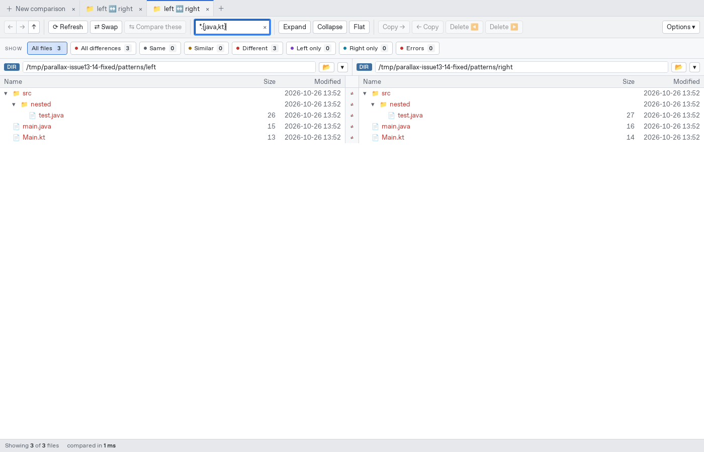
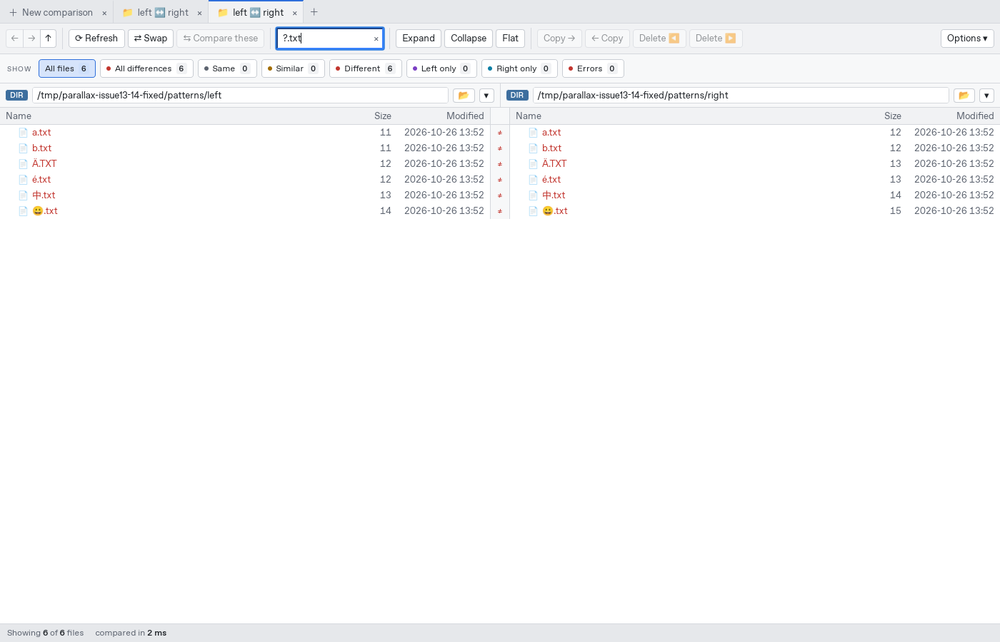
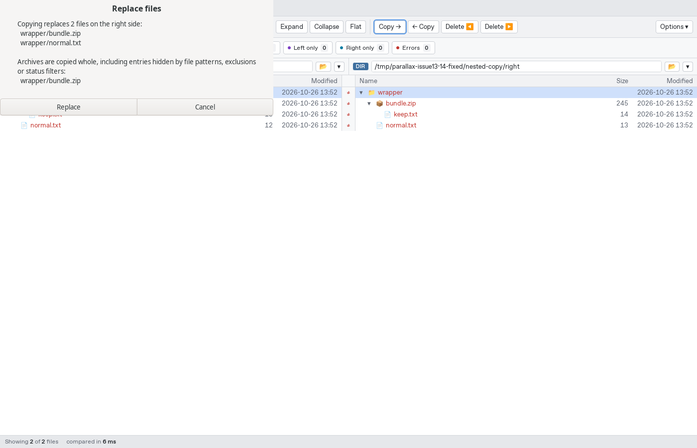
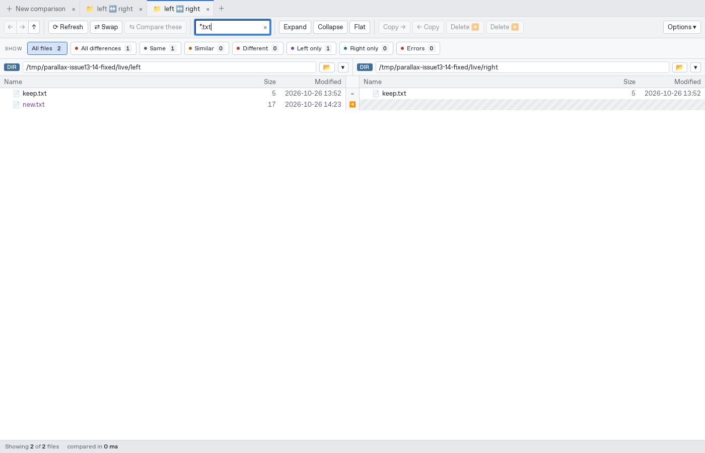

# Validation of fixes for issues #13 and #14

## Folder patterns (#13)

| Finding | Change | Validation |
|---|---|---|
| W01: splitting brace alternatives and literal names | Include/exclude fields share a glob-aware tokenizer. Braces and classes stay together; quotes and escaped separators allow filenames containing spaces, commas and semicolons. Reopened views preserve pattern lists. | Parser tests; native GUI `*.{java,kt}` selects three files; each quoted literal selects exactly one; excludes accept alternatives and quoted commas. |
| W02: byte-oriented Unicode matching | Validated glob regexes are compiled with Unicode character and case semantics. `?` consumes one Unicode scalar. Includes ignore case; excludes retain their case-sensitive contract. | Rust tests for accented characters, CJK, emoji, ranges, escapes, alternatives, path separators and newlines; GUI `?.txt` finds all six one-character filenames, and `ä.txt` finds `Ä.TXT`. |
| W03: hidden archive entries overwritten behind a member-file confirmation | Archives remain atomic copies. The confirmation stops at archive boundaries, names the whole archive and explicitly warns that hidden entries are included. This also asks before copying a new archive. Selecting individual members still copies individual members. | Copy preview test and native dialog screenshots; cancel preserves the destination; accept copies the full archive. |
| W04: parent copy skips an archive containing matches | Parent traversal searches archives for matching descendants before deciding whether to copy their whole container. Unmatched/excluded archives stay skipped. Both filesystem and archive destinations use this policy. | Rust copy regression; native GUI parent copy includes `wrapper/bundle.zip` and `wrapper/normal.txt`, with a whole-archive warning. Ordinary filtered directories preserve hidden files. |
| W05: no-match filters retain identical Git folders | A Git tree-id shortcut is used only when includes cover the whole subtree. Selective filters walk tree metadata and prune empty results. | Real-Git regression and native `missing*.txt` comparison produce zero rows. |
| W06: incremental refresh leaks nonmatching files | Refresh applies the same includes/excludes as the full walk. After the last visible child disappears, newly empty ancestors are checked and pruned. Nonmatching changes do not force a full comparison. | Rust refresh regression and real watcher events in the native GUI: hidden edits/creations remain hidden, matching creations appear, empty ancestors disappear. |

### Screenshots from the bundled native app









The native dialog appears at the top left because the headless X display has no window manager.

## Archive I/O (#14)

A comparison-scoped view memoizes whether a path component is an archive. Parsed indexes remain shared, but the type memo is discarded between operations. Initial archive opens are serialized to avoid redundant parsing by parallel workers. A regression caps backing VFS metadata calls independently of member count and checks an archive replaced by a directory.

Local containers use buffered, seekable file handles with independent reader positions. ZIP indexing uses central-directory metadata rather than opening every local member header. Windows no longer creates a full in-memory copy merely to avoid retaining a memory mapping. ZIP, 7z and TAR readers and writers share this input abstraction; nested/in-memory archives still use shared bytes.

Every archive rewrite reopens the current container under the process-wide write lock. This replaces the old full-byte stale-save comparison and preserves unrelated updates from other tabs/programs, including same-size/same-time replacements. Existing tests for concurrent sources, replacement, nested writes, cancellation and format round trips pass.

### Latency reproduction

Four Rayon workers; warm second comparison; only backing VFS `stat` is delayed. Before: issue #14 measurements against `711b413`. After: application based on `df58244` with these fixes. The later `9f99fa6` main change adjusts a Windows test only.

| Entries | Stat delay | Mode | Before | After | Backing stat calls, before → after |
|---:|---:|---|---:|---:|---:|
| 100 | 2 ms | default | 0.1729 s | 0.0104 s | 306 → 4 |
| 1000 | 0 ms | default | 0.0051 s | 0.0072 s | 3006 → 4 |
| 1000 | 2 ms | default | 1.6104 s | 0.0153 s | 3006 → 4 |
| 1000 | 10 ms | default | 7.6544 s | 0.0476 s | 3006 → 4 |
| 1000 | 2 ms | equal CRC | 0.0141 s | 0.0101 s | 6 → 4 |
| 1000 | 2 ms | raw bytes | 0.0138 s | 0.0096 s | 6 → 4 |
| 1000 | 2 ms | verify equal | 1.5956 s | 0.0178 s | 3006 → 4 |

All results retain their expected file counts and statuses. Timings are single warm rounds, not statistical benchmarks. These are **simulated metadata delays on local archive bytes**, not SMB/NFS/SharePoint measurements or network packet counts. No Windows runtime was available locally; Windows coverage comes from the repository CI. Compressed TAR indexing, solid 7z decoding and whole-container writes still have their inherent format costs.

Full before/after reproduction source and machine-readable after results: [probe.rs](probe.rs), [results.json](results.json). The original before results are linked from issue #14.

```sh
python3 docs/reviews/2026-10-26-issues-13-14-fixed/create-fixtures.py --directory /tmp/parallax-archive-latency
cargo build --release -p parallax-core
rustc --edition=2024 -O docs/reviews/2026-10-26-issues-13-14-fixed/probe.rs \
  --extern parallax_core=target/release/libparallax_core.rlib \
  -L dependency=target/release/deps -o /tmp/parallax-archive-probe
RAYON_NUM_THREADS=4 /tmp/parallax-archive-probe /tmp/parallax-archive-latency 1000 10 default
```

Modes: `default`, `equal`, `verify`, `bytes`; entry counts: `100`, `1000`. The program prints both cold and warm rounds. Adjust the build paths when using `CARGO_TARGET_DIR`.

## Checks

- `cargo test --workspace`: 394 passed, 3 existing ignored tests.
- `cargo clippy --workspace --all-targets -- -D warnings`: passed.
- `cargo fmt --all --check`: passed.
- Frontend check: zero errors/warnings; 15 tests passed; production build passed.
- Native production release build with `tauri/custom-protocol`: passed.
- Bundled native GUI: [18 checks passed](gui-checks.json), no JavaScript errors. Disposable fixtures exercise real files, ZIPs, Git revisions and filesystem watcher events.
